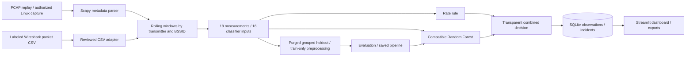

# SentinelWiFi

**Intelligent Wireless Intrusion Detection and Monitoring**

A working local WIDS university prototype: Scapy parses raw IEEE 802.11 traffic, rolling windows produce a canonical feature schema, a rate rule and an optional Random Forest detect suspicious activity, and SQLite persists evidence for a six-page Streamlit dashboard. No packet injection, Wi-Fi disruption, or automatic network configuration is implemented.

## Quick start

Python 3.11+ (tested on 3.12). From the project root:

```powershell
python -m venv .venv
.venv\Scripts\Activate.ps1
python -m pip install -e ".[dev]"
python -m wids.cli fixture
python -m streamlit run app.py
```

On Linux/macOS activate with `source .venv/bin/activate`. The dashboard binds to **http://127.0.0.1:8501**. Open **Wireless Traffic Monitor**, choose **Synthetic PCAP demo**, and press **Start / Restart**. The 50-second recording moves from ordinary activity to occasional deauthentications, a concentrated flood at 25 seconds, and recovery. Its 1,320 packets are synthetic, written only to disk, and never transmitted. It demonstrates actual parsing, detection and incident persistence; it is not model evaluation evidence.

For a headless demonstration:

```text
python -m wids.cli replay data/demo/synthetic_deauth.pcap --provenance synthetic
python -m wids.cli export
python -m pytest -q
```

Rule detection works without a model. A model must be trained locally before ML inference is available in a Git clone; model binaries are deliberately gitignored. The submission ZIP includes the trusted locally trained model and derived feature table.

## Genuine dataset and model training

The initial evaluated dataset is the **Deauth subset of The WPA3 Dataset**, published at [hsngccu/WPA3-dataset](https://github.com/hsngccu/WPA3-dataset), pinned to commit `e07113327e2012a861f3e273e10ed9b02f0491f4`. The repository carries an MIT license; its notice and exact download manifest are retained in `docs/sources/`. Raw files are not committed.

```text
python scripts/download_public_dataset.py
python -m scripts.prepare_dataset
python -m scripts.train_model
python -m scripts.evaluate_model
```

The downloader retrieves 62 labeled CSV segments and one PCAP (about 119 MB), verifies Git blob hashes on download, and records SHA-256 checksums. The preparation command streams CSV chunks in numeric segment order through the same rolling feature extractor as packet replay. CSVs include genuine `Normal` and `Deauth` publisher labels; labels are never created from the detector rule. Of 18 extracted measurements, 16 enter the classifier. RSSI mean/variability remain analysis-only because publisher and Scapy antenna selection differs. The matched PCAP/CSV check found zero differences in all 16 predictive features across 302 windows: `python -m scripts.verify_feature_compatibility`.

The executed fixed holdout contains 2,802 windows: accuracy **99.50%**, precision **92.26%**, recall **98.62%**, F1 **95.33%**, ROC-AUC **0.99927**. Confusion matrix, actual rows then predicted columns, order Normal/Malicious: `[[2645,12],[2,143]]`. Training uses 3,484 windows. These are **within-recording, purged temporal-block results**, not independent-session validation or a deployment guarantee. There are 1,023 test feature rows also observed in training; repetitive radio traffic limits independence. See `reports/evaluation.json` and `docs/MODEL.md`.

AWID3 is preferred for later comparison. Its [current access form](https://icsdweb.aegean.gr/awid/download) requires institutional registration and approval. The original `/download-dataset` URL returns 404. The user has submitted and confirmed an access request; download remains pending. Do not rename the current results as AWID3 results. Import AWID3 only after inspecting its actual schema and label definitions. AWID2's headerless representation is not supported automatically.

## Features and architecture



- Dataset inspection, explicit label mapping, bounded CSV chunk ingestion, genuine supervised evaluation.
- Beacon/probe/authentication/association/disassociation/deauthentication recognition, data/control frames, retry, reason code, RSSI where available and DS-aware BSSID parsing.
- Five-second rolling observations, one-second step, per-transmitter/BSSID aggregation; fixed memory ceilings and gap cleanup.
- Configurable flood threshold and cooldown. ML absence or disagreement remains visible.
- Background replay worker with start/pause/resume/stop/restart and browser heartbeat; refresh never starts another worker.
- SQLite session tracking, atomic observation/incident persistence, WAL, status audit events and explicit synthetic history clearing.
- Security Overview, Wireless Traffic Monitor, Attack Detection, Machine Learning Analytics, Security Incidents, Settings.
- Plotly charts, real confusion matrix, fitted feature importance, CSV/JSON exports, scientific A1 landscape poster.

## Alerts and evidence

Default rule: at least two deauthentication frames and **10 frames/s over 5 seconds** for one observed transmitter/BSSID. One legitimate deauthentication is not a flood. Defaults require tuning for the environment. High severity means the rate rule fired; Critical means rate >= 5 times threshold; Medium means ML only. `rule`, `ml`, and `both` name the source. ML confidence is uncalibrated P(malicious), not a verified attack probability. Binary ML does not identify individual attack types.

Raw counters count each packet once. Observation counts overlap and must not be summed as packet totals. Capture times are UTC epochs; the overview reporting period uses ingestion time. Every session records its provenance. The engine retains metadata only, with at most 100 recent parsed frames in memory; uploaded/raw source files remain on disk until manually removed. Observed MAC addresses can be spoofed and do not identify an attacker.

## Optional live capture

Linux only, compatible adapter already in monitor mode (sysfs interface type 803), proper capture permissions, and explicit confirmation of network authorization in the UI. Run `python -m wids.cli interfaces` to inspect availability. This application never enables monitor mode, escalates privileges, or disconnects networking. Do not run the entire dashboard as root. Ask a lab administrator to configure the authorized capture environment. Windows ordinary Wi-Fi interfaces are not offered as raw 802.11 sources; PCAP replay works without Npcap/libpcap.

## Reports, poster and demonstration

**Machine Learning Analytics** displays evaluation and training controls; training occurs only on explicit action. **Security Incidents** supports filters, search, details, status updates and CSV export. **Settings → Export monitoring report** or `python -m wids.cli export` writes actual sessions/incidents/observations/events to `reports/`.

```text
python -m scripts.generate_poster
```

The A1 (841 × 594 mm) PDF is written to `output/pdf/sentinelwifi_A1.pdf`. It reads actual saved metrics and implementation screenshots. Student identity placeholders must be filled before submission. If evaluation or screenshot evidence is absent, the generator labels the poster a draft and leaves the missing sections explicit. See `docs/DEMONSTRATION.md` for the 10-minute script and fallback. The required video must be recorded in the week after submission; no video is claimed to exist.

## Testing and troubleshooting

```text
python -m pytest -q --junitxml=reports/tests.xml
```

Tests cover packet parsing, feature boundaries, model isolation and serialization, ML/rule disagreement, cooldown, SQLite status/persistence, full synthetic replay, worker lifecycle and all dashboard pages. Full details: `docs/TESTING.md`.

| Symptom | Action |
|---|---|
| `python` unavailable | Install Python 3.11+ and reopen the terminal; this build used the Codex bundled 3.12 runtime. |
| PowerShell activation blocked | Use `.venv\Scripts\python.exe -m ...` directly; changing execution policy is unnecessary. |
| No libpcap provider warning on Windows | Offline `PcapReader` still works; raw live capture is Linux-only. |
| No ML predictions | Train locally; check model window/step and feature version. |
| CSV missing required fields | Inspect the schema; do not substitute unrelated feature columns. |
| Out-of-order timestamps | Reorder the recording segments or externally sort by capture time. |
| No raw wireless frames | Obtain Radiotap/802.11 PCAP; Ethernet lacks wireless management headers. |
| Browser closed and capture stopped | Intentional 30-second lease; restart a new session. |
| Port occupied | Use `--server.port 8502` and visit the matching localhost URL. |

## Limits and academic status

The baseline is operational and evaluated on an accessible real research subset. AWID approval and independent-session evaluation remain external work. Live hardware capture is implemented but not exercised on this Windows machine. MAC spoofing, packet loss, protected frames with unreadable reasons, source fragmentation, encrypted payload attacks and different radio conditions limit inference. No WIPS network enforcement is implemented. Automated tests do not establish operational security effectiveness. See `docs/ACCEPTANCE.md` for the explicit delivery audit and `docs/TECHNICAL_DEFENSE.md` for the oral explanation.

OpenAI Codex assisted implementation, tests and documentation. The student must review, understand and demonstrate the system; see `docs/AI_USAGE.md`.

## References

- The WPA3 Dataset, [publisher repository and license](https://github.com/hsngccu/WPA3-dataset).
- E. Chatzoglou, G. Kambourakis, C. Kolias (2021), *Empirical Evaluation of Attacks Against IEEE 802.11 Enterprise Networks: The AWID3 Dataset*, IEEE Access 9, 34188–34205. DOI: [10.1109/ACCESS.2021.3061609](https://doi.org/10.1109/ACCESS.2021.3061609).
- [AWID3 schema and ground-truth guidance](https://icsdweb.aegean.gr/awid/awid3).
- [Scapy Dot11 API](https://scapy.readthedocs.io/en/latest/api/scapy.layers.dot11.html).
- [Scikit-learn GroupShuffleSplit](https://scikit-learn.org/stable/modules/generated/sklearn.model_selection.GroupShuffleSplit.html).
- [Streamlit fragment execution](https://docs.streamlit.io/develop/api-reference/execution-flow/st.fragment).
